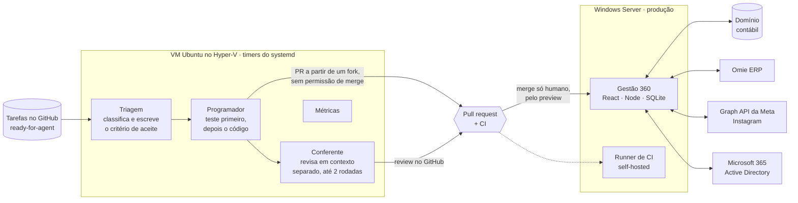

# Gabriel Caetano

**Automação com IA · Infraestrutura · Desenvolvimento de sistemas**

Goiânia, Brasil · Ciência da Computação na PUC Goiás

---

TI de um grupo de 8 empresas e sou o principal desenvolvedor do sistema de gestão delas. Quando um processo se repete, eu transformo em código. Quando o código se repete, transformo em agente.

O projeto de que mais me orgulho é uma **fábrica de agentes de IA** que pega tarefas no GitHub, escreve o código com teste e abre o PR. Outro agente revisa, e um humano aprova olhando a tela.

## 🏭 A fábrica

Como a fábrica foi pensada:

- **Menor privilégio.** Os agentes trabalham numa conta e num fork próprios. Não fazem merge, não leem `.env`, não mexem no CI nem no esquema do banco.
- **Texto é dado, nunca ordem.** Se uma tarefa disser "ignore as regras", o agente marca `needs-human` e para. É a defesa contra prompt injection.
- **Sabe parar.** Se falta informação, se a tarefa cresceu ou se o teste falha sem motivo claro, o agente troca a etiqueta e espera um humano. Com 3 PRs aguardando revisão, ele não pega tarefa nova.
- **Aprende com o erro.** Cada PR devolvido vira uma linha num arquivo de lições que os agentes leem antes de cada tarefa.
- **Produção vem primeiro.** Os agentes rodam com prioridade baixa e o CI roda com poucos workers, para não disputar recurso com o sistema em uso.

**Primeiros 11 dias:** 23 PRs abertos pela fábrica, 19 aprovados e integrados.

## 📊 Em números

| | |
|---|---|
| **Gestão 360** | 17 módulos · 77 rotas de API · 1.500+ arquivos de teste · 2.700+ commits em 5 meses |
| **O que ele substituiu** | um SaaS de atendimento omnichannel, um BI de controladoria e uma aplicação financeira anterior |
| **Suporte** | 1.639 chamados atendidos no GLPI · mediana de 3,3 h até fechar · 68% fechados em menos de 24 h |
| **Escopo** | 8 empresas · cerca de 100 usuários · AD, Microsoft 365, FortiGate, VPN |

O código do Gestão 360 e da fábrica é privado da empresa. Mostro a arquitetura e os PRs em entrevista.

## 🧪 Projetos públicos

| Projeto | O que é | Stack |
|---|---|---|
| [**glpi-ia-diagnostico**](https://github.com/g-Ac/glpi-ia-diagnostico) | Diagnóstico remoto de estações Windows, só leitura, que publica o relatório no chamado do GLPI | PowerShell · WinRM · Pester |
| [**crypto_ai_bot**](https://github.com/g-Ac/crypto_ai_bot) | Bot que analisa mercado, aplica regras de risco e simula operações (paper trading). Roda 24/7 num Raspberry Pi, com ~690 testes | Python · pytest · systemd · Telegram |
| [**agents-global**](https://github.com/g-Ac/agents-global) | Agentes e prompts especializados para desenvolvimento com Claude Code | Shell · Markdown |
| [**Território**](https://github.com/g-Ac/Game) | Jogo de estratégia por turnos com engine de simulação puro e testado | Expo · TypeScript · Jest |

## 🛠️ Stack

**IA e automação** · Claude Code em modo headless · API da Anthropic · agentes com aprovação humana · geração de imagem e vídeo · Graph API da Meta · Telegram Bot API

**Desenvolvimento** · JavaScript · TypeScript · React · Node · Python · PowerShell · SQLite · SQL Server · Vitest · pytest · GitHub Actions

**Infraestrutura** · Hyper-V · Windows Server · Ubuntu · systemd · Active Directory · Microsoft 365 · Entra ID · FortiGate · Docker · Tailscale

## 📌 Como eu uso IA

A IA escreve mais rápido do que eu. O que ela não decide é o que pode rodar em produção. Por isso, em tudo o que eu construo, a lógica fica separada do I/O, todo comportamento tem teste, os segredos ficam fora do código e nada escreve em sistema real sem um humano aprovar.
